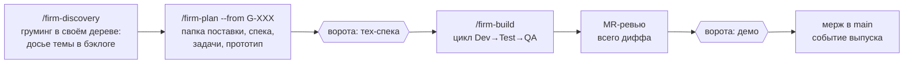
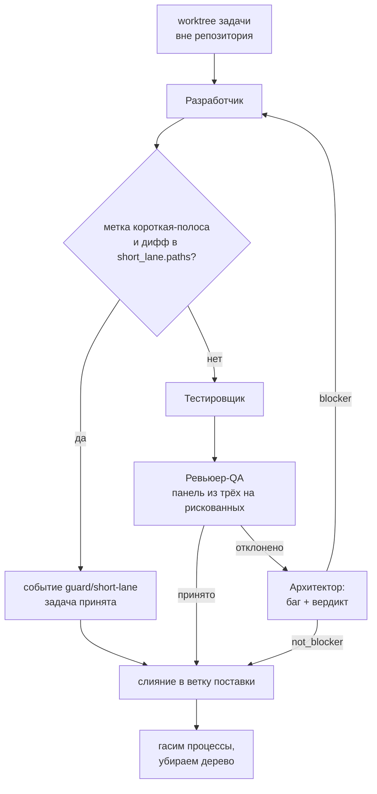
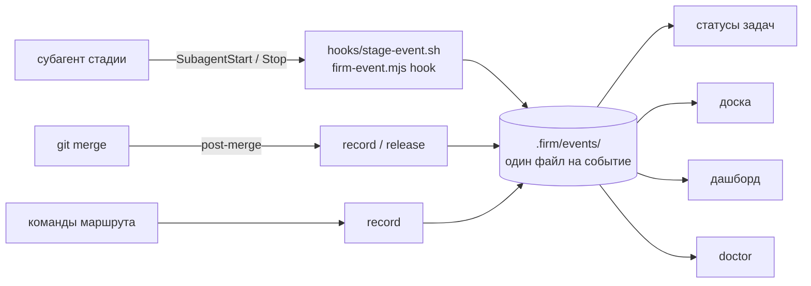

# Как работает firm2

Схема маршрута на 23.09.2026, версия движка 0.2.4. Это описание того, что
получилось после первой обкатки на живом проекте; замысел и его обоснования —
в `firm2-design.md`, трудно-обратимые решения — в `adr/`.

Здесь — устройство, а не намерения: три сессии, двое человеческих ворот,
параллельная сборка в отдельных рабочих деревьях и журнал переходов, который
пишет код, а не модель.

## 1. Маршрут: три сессии

Сессии разделены намеренно: у каждой свой предмет, а переход между ними — точка,
где человек может остановиться, не потеряв состояние. Состояние целиком лежит в
файлах репозитория, а не в контексте разговора.

Ромбами отмечены ворота человека. Граница «разведка → планирование» воротами
**не** считается: запуск следующей команды человеком сам по себе есть акт
одобрения.

Разведка **не стоит в очереди за сборкой**: она всегда работает в своём дереве
`<repo>.groom/G-XXX-<слаг>` на ветке от `main`, поэтому грумить следующую тему можно
параллельно идущей поставке и в нескольких сессиях разом (ADR-0012). Стрелка на схеме —
про порядок работы над одной темой, а не про занятость машины.

| Сессия | Что происходит |
|---|---|
| разведка (груминг) | PM опрашивает человека, Оркестратор — транспорт и своих вопросов не сочиняет. Идёт в своём рабочем дереве от `main`. На выходе досье темы `docs/backlog/G-XXX-<слаг>/` (требования, решения, влияние на код, перечень экранов), BRD, ADR, словарь домена. **Поставку не заводит** (ADR-0012) |
| планирование | Вливает ветку груминга (`groom land`) и заводит папку поставки. PM раскладывает досье в `proposal.md`, Архитектор режет задачи, ставит `depends_on`, `parallel_safe` и метки. Дизайнер рисует один прототип на всю поставку. Первым входом ворот идёт путь пользователя (`user-path.md`): он один видит ОТСУТСТВИЕ шага, прочие гейты сверяют связность плана |
| сборка | Workflow ведёт цикл по задачам. Оркестратор держит границы, которых код не достаёт: арбитраж, ревью поставки целиком, демо |

## 2. Цикл одной задачи

Не больше трёх попыток. Любое «отклонено» заводит баг — даже когда его решат не
чинить: след должен остаться.

**Короткая полоса** — единственный законный способ не открыть стадии надзора, и держится
он на двух условиях сразу: метку `короткая-полоса` ставит планирование, а заявку судит
код по НАСТОЯЩЕМУ диффу ветки задачи против ветки поставки (`firm-state.mjs lane-check`).
Вышел дифф за `short_lane.paths` — полоса отменяется и задача идёт полным циклом; ключа в
конфиге нет или зонд не ответил — тоже полный цикл. Пропускаются только стадии: файл
задачи, её критерии и событие в журнале остаются. Повод — замер проект-В: правка строки
словаря стоила 41 секунды разработки и 24 минут 36 секунд тестирования.

Планировщик — **код, а не модель**. Решение модели было бы недетерминированным
ровно там, где нужна повторяемость. Его правила:

- потолок — три задачи одновременно, каждая в своём рабочем дереве
  `../<repo>.worktrees/T-XXX`;
- задача без `parallel_safe` идёт одна; пока другие в работе, она ждёт, но
  пропускать её ради следующих можно — иначе слоты простаивают зря;
- задача с меткой `требует-браузера` встаёт раньше равных по готовности: её
  хвост определяет, когда закончится весь прогон;
- зависимость на задачу вне прогона считается выполненной, но об этом говорится
  вслух: чаще это опечатка в `depends_on`, чем намерение;
- перед запуском каждой новой задачи проверяется пауза. Начатые доводятся до
  конца вместе со слиянием;
- **план прогона дополняется по ходу.** Перед запуском новой задачи зонд состояния
  спрашивает поставку, и задачу, пригодную к работе СЕЙЧАС (статус `ready` или
  `rework`, попытки не кончились), прогон добирает в очередь — заведённую после
  старта или вернувшуюся в цикл. Границы: один добор на задачу за прогон и только
  пока в очереди или в работе осталась задача ПЛАНА — мандат прогона это его план
  (ADR-0009). Повод — замер прогона 2026-10-23: занятость 1,73 слота из трёх и
  5,5 слото-часов простоя при готовой задаче в поставке (Д-14).

## 3. Кто пишет события

Несущая конструкция маршрута (ADR-0002). Переходы стадий пишет код — хуки
рантайма и git-хук, — потому что шаг внутри движка можно обойти, а хук нет.
Модель событий не пишет вовсе.

Один файл на событие — чтобы параллельные ветки задач сливались без конфликтов
(ADR-0003). Каталог `.firm/events/` коммитится: это и есть журнал.

Хук пишет событие только для роли, названной в таблице `STAGE_BY_AGENT`
(`scripts/firm-event.mjs`), — на любой другой он молча выходит. Роль, забытая в таблице,
не даёт событий вовсе, и это не теория: замер 22.10.2026 по четырём живым журналам дал
**0 событий `docs/*` и `design/*` на 2 511 событий при 213 закрытых поставках** — стадии
архива спеки и прототипа были невидимы целиком, а пустая колонка дашборда читалась как
«стадия не шла». С 0.4.94 обе роли в таблице; тикета у них нет по устройству (архив и
прототип принадлежат поставке), поэтому их промпты несут маркер `FIRM2-TICKET: MR` — как
MR-ревью. Имя стадии при записи сверяется со словарём `STAGES`: до 0.4.94 `record`
принимал любое, и в журнал проект-В уехала стадия `gate`, которой в словаре не было.

| Источник | Что пишет | Чем держится привязка |
|---|---|---|
| хук стадии | `dev`/`test`/`review` — старт и финиш, вердикт ревью, критерии приёмки | маркер `FIRM2-TICKET` из промпта стадии; на старте транскрипта ещё нет, тикет достраивается по `agent_id` при чтении |
| git `post-merge` | `merge/finished` задаче, `release/finished` поставке | имя влитой ветки: `task/T-XXX` или `feature/<имя поставки>` |
| стадия слияния | `merge/failed` — отказ, которого git-хук не увидит | явный `--ticket` в команде |
| команды маршрута | границы, куда хуки не достают: MR-ревью поставки, ручные отметки | маркер `FIRM2-TICKET: MR` либо `record --ticket` |

Роль, у которой стадия в таблице есть, зовётся **либо с маркером, либо с названной
причиной, почему события нет**. Второе — не лазейка: стадия у роли в таблице ровно одна, а
работ у неё бывает больше. Архитектор в сборке арбитрирует (`adjudicate`), а на груминге и
планировании пишет досье и спеку — событие `adjudicate` на планировании приписало бы
поставке стадию, которой не было, то есть дало бы не дыру, а ложь, которую `doctor` не
ловит. Поэтому у таких вызовов причина написана словами рядом с запуском, и это
проверяется: шаг рубежа 3у (`scripts/roles.mjs`) считает находкой вызов, у которого нет ни
маркера, ни причины.

Там же сверяется и остальная формальная часть таблицы ролей — какую схему вызов передаёт
роли против того, что роль объявила своим выходом; приёмы и шаблоны, которые она называет,
против того, что в движке есть; имена в карте `A` сборщика против того, что реально
зовётся. `node firm2/scripts/roles.mjs` печатает снимок целиком, `--json` отдаёт его
машине: схема «вход и выход каждой роли» собирается из этого вывода, а не пишется по
памяти — промпты и схемы меняются каждым разбором стадии.

> **Инвариант.** Статус в frontmatter задачи — производный кэш. Авторитетен
> журнал; при расхождении побеждает журнал, а кэш пересчитывается молча.
> Второй источник истины однажды разошёлся бы с файлами, поэтому его нет
> (ADR-0001).

## 4. Что из журнала выводится

Ничто из этого не хранится — всё считается из событий при каждом обращении,
поэтому рассинхронизироваться ему не с чем.

| Производное | Откуда берётся | Зачем |
|---|---|---|
| статус задачи | последовательность событий: `dev/started` → `in_progress`, `merge/finished` → `merged` | доска, отбор задач в прогон |
| доска | задачи из файлов + статусы из журнала + занятые слоты | «сколько осталось» без запуска сборки |

Занятый слот — это **задача**, а не работающий агент: потолок `parallelism` меряет,
сколько задач ведётся одновременно, каждая в своём worktree. На одной задаче агентов
может быть несколько сразу — состязательная панель QA это три ревьюера, — и считать их
поштучно значит считать одну задачу трижды. Отдельно к занятым прибавляются только
непривязанные старты стадии `dev`: у них тикета ещё нет по устройству момента, но
задачу они уже ведут.
| тайминг | пары старт/финиш по стадиям | календарное против активного: разница есть ожидание |
| токены | поле `tokens` в событиях финиша (usage из транскрипта стадии, дедуп по `requestId`), с разбивкой `by_model` | во что задача обошлась, какая стадия жжёт контекст и чем именно тратила — цена токена у Sonnet и Opus разная в разы. **Занижено на механические вызовы DevOps** (их пять на задачу: зонд паузы, подготовка дерева, полоса, запись события, слияние) — они событий не пишут, и журналировать их значило бы удвоить журнал ради интервалов, в которых нет решений (разбор стадии DevOps 22.10.2026) |
| дашборд | всё перечисленное + баги с названиями и пометками задач-исправлений | ответ на вопрос «можно ли отдавать» |
| `doctor` | дыры: события без тикета, незакрытые стадии, отказавшие слияния, битые файлы | стоп перед запуском, а не «потом» |

Стадии: `dev` → `test` → `review` → `merge` → `release`.
События: `started`, `finished`, `accepted`, `rejected`, `escalated`, `failed`.

Отказ слияния статус задачи не меняет — она принята, но не влита. Меняется
состояние поставки, и о нём кричит `doctor` (`failed_merges`, `ok: false`).

## 5. Изоляция и границы

- **Рабочие деревья — вне репозитория.** Внутри держать нельзя: codegraph
  индексирует дерево целиком и посчитал бы каждое за отдельную копию кода.
- **Песочница.** `firm-permissions.mjs` добавляет каталог деревьев и кэши
  инструментов по маркерам проекта. Намеренные запреты (`./.claude`, `.env`,
  ключи) не трогает.
- **Пути в стадиях — только абсолютные.** Рабочий каталог сессии есть корень
  проекта, и относительный путь молча уходит в главное дерево.
- **Уборка.** Процессы задачи гасятся по пути дерева, дерево снимается двумя
  командами: `worktree remove` и `worktree prune`.

### Чего движок не делает — намеренно

- **Не переносит секреты в рабочее дерево.** Дерево получает версионируемое, а
  `.env` под песочницей нечитаем. Вместо этого предупреждает, что тесты должны
  обходиться без него.
- **Не чинит себя из проекта.** Код движка общий для всех проектов под firm2;
  правка из одной сборки уехала бы в чужие. Найденный дефект описывается словами
  и обходится в рамках поставки.
- **Не ставит инструменты.** Глобальный пакет меняет машину целиком — это
  решение человека, как и `gh auth login`.
- **Не переписывает журнал задним числом.** Неверная привязка чинится при
  чтении, а не правкой записанных файлов: журнал есть запись того, что было
  известно в тот момент.

## 6. Что изменила обкатка

Плагин написан 21.09.2026 и вживую не прогонялся. Почти всё ниже — дефекты,
которых замысел не предвидел; их показал первый живой прогон. Подробности — в
`../CHANGELOG.md`.

| Версия | Чему научился |
|---|---|
| 0.1.0 | собран по замыслу; ключевой узел проверен зондом |
| 0.2.0 | журнал перестал теряться при уборке; стадии перестали писать в главное дерево; пауза, монитор, баги на доске, метка `требует-браузера` |
| 0.2.1 | версия — механизм доставки: кэш плагина обновляется по ней, иначе правка команд до проектов не доезжает |
| 0.2.2 | отказ слияния стал событием; релиз находит задачи после архивации спеки; стадиям запрещено трогать чужие файлы и общее хозяйство проекта |
| 0.2.3 | заглушка `T-XXX` из шаблона бага перестала считаться тикетом; выпуск идемпотентен |
| 0.2.4 | в событии выпуска записан тот, кто его позвал, а не хук по умолчанию |
| 0.2.5 | слот на доске — задача, а не агент; номера задач и багов сквозные по проекту и выдаются движком |
| 0.3.0 | движок `agent-dev-firm` удалён, роли и приёмы переехали в firm2 |
| 0.3.1 | кэш статуса не пишется в главное дерево, пока задача не влита; журнал коммитится ДО слияния; шаг слияния разбирает отказ песочницы |
| 0.4.0 | запись стадии в главное дерево отклоняется механически, хуком, а не текстом промпта |
| 0.4.1 | preflight пробует запись в каждый каталог поставки и различает песочницу (EPERM) и права ФС (EACCES) |

Урок, стоящий отдельно: длительность стадии предсказывала не сложность кода, а
необходимость поднять браузер — медиана разработки 6 минут против 1,4 часа на
одной задаче с живой проверкой. Отсюда метка, а не догадки.
